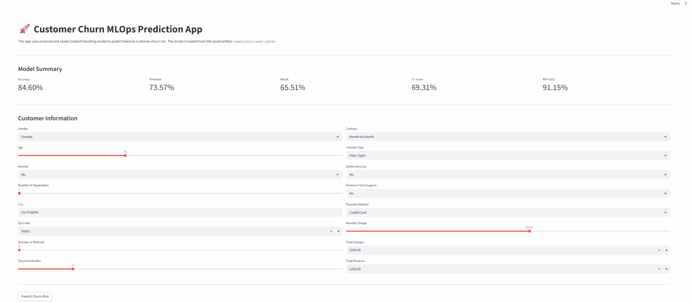
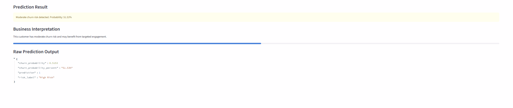
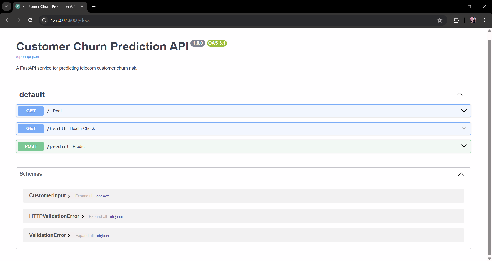

# Telecom Customer Churn | MLOps-Style ML Pipeline

An end-to-end **machine learning portfolio project** for estimating telecom customer churn risk, from dataset preparation and model comparison to a validated prediction API and an interactive user interface.

**Stack:** Python · pandas · scikit-learn · FastAPI · Pydantic · Streamlit · pytest · Joblib · Docker (configuration included)

> **Project scope:** This is an MLOps-style prototype, **not a validated production deployment**. The project includes an inference API, model artifact, tests, and a Dockerfile; it does not yet include automated CI/CD, monitoring, drift detection, or prospective validation.

## Highlights

- **25 required customer features** in the current model and API, reduced from an earlier 32-feature version.
- Gradient Boosting classifier with imputation, encoding, and numeric scaling inside a scikit-learn `Pipeline`.
- Feature-group ablation and stratified cross-validation on the training split.
- A configurable **decision threshold of `0.30`**, explored using out-of-fold training predictions and an illustrative business-cost model.
- FastAPI `POST /predict` with Pydantic validation (`422` for incomplete or unexpected fields).
- Streamlit form using the same prediction function as the API; **Streamlit calls Python inference directly, not the HTTP API**.
- Automated API, inference, and decision-threshold tests.

## Architecture

```text
                  Maven Analytics telecom churn CSV
                               |
                      Data preparation
                (target, missing values, drops)
                               |
                  Stratified train/test split
                               |
               Training-only feature experiments
                       and cross-validation
                               |
                scikit-learn preprocessing +
                   GradientBoostingClassifier
                               |
                 Saved 25-feature Joblib model
                               |
                     src/predict.py
               (predict_proba + threshold 0.30)
                         /             \
                        /               \
            FastAPI /predict         Streamlit app
             HTTP interface         direct Python call
```

## Repository Layout

```text
churn-mlops-pipeline/
├── api/
│   └── main.py                     # FastAPI endpoints and 25-field schema
├── app/
│   └── streamlit_app.py           # Interactive 25-feature input form
├── data/
│   ├── raw/                       # Local input dataset; ignored by Git
│   └── processed/                 # Generated data; ignored by Git
├── models/
│   ├── churn_model.joblib         # Original model artifact, if retained
│   └── churn_model_25features.joblib
├── results/
│   ├── metrics.csv                # Historical 32-feature results
│   └── metrics_25features.csv     # 25-feature results at threshold 0.50
├── src/
│   ├── config.py                  # Model path and decision threshold
│   ├── data_loader.py
│   ├── preprocessing.py
│   ├── train.py
│   ├── predict.py
│   └── evaluation.py
├── tests/
│   ├── test_prediction.py
│   ├── test_api.py
│   └── test_threshold.py
├── check_financial_features.py   # Financial-feature ablation
├── check_geography_cv.py         # Training-only feature-group CV
├── check_threshold_cv.py         # Training-only threshold analysis
├── train_reduced_model.py        # Trains the 25-feature artifact
├── main.py                       # Original training entry point
├── Dockerfile                    # Container configuration
├── requirements.txt
├── .gitignore
└── README.md
```

## Dataset and Prediction Target

The project uses the **Maven Analytics Telecom Customer Churn** dataset, with **7,043 records** in the original local file. The input file is expected at:

```text
data/raw/telecom_customer_churn.csv
```

The raw dataset is excluded from version control. Obtain it from its original dataset provider and place it at the path above to reproduce training and evaluation. Check the dataset's terms before redistributing it.

The original `Customer Status` field is mapped to the binary target:

| Original status | Binary target |
|---|---:|
| `Churned` | `1` (churn) |
| `Stayed` | `0` (not churn) |
| `Joined` | `0` (not churn) |

**Interpretation caveat:** Combining `Stayed` and `Joined` is the definition used in this experiment. It is not equivalent to a validated *future churn within a fixed prediction window* target. A time-indexed dataset and a defined observation/prediction window would be needed for a prospective churn forecasting claim.

## Data Processing and Feature Selection

The pipeline handles the target, service-related missing values, and excluded fields before model fitting. Numerical features use median imputation and scaling; categorical features use most-frequent imputation and `OneHotEncoder(handle_unknown="ignore")`. The fitting stages are contained in a scikit-learn pipeline.

The project excludes identifiers and target-revealing fields such as `Customer ID`, `Churn Category`, and `Churn Reason`, as well as latitude and longitude. The current 25-feature model also removes:

```text
City
Zip Code
Total Revenue
Total Charges
Total Refunds
Total Extra Data Charges
Total Long Distance Charges
```

`City` and `Zip Code` were investigated as high-cardinality geographic features. The five financial variables were examined as a group; in this dataset, `Total Revenue` is algebraically determined by the other four:

```text
Total Revenue = Total Charges - Total Refunds
              + Total Extra Data Charges + Total Long Distance Charges
```

**Important:** Redundancy does not, by itself, establish data leakage. The removal decision reflects feature simplification and exploratory ablation results. Availability of all remaining variables at the intended prediction time still needs to be confirmed.

### Current Input Schema (25 Required Features)

The API uses these snake_case field names; Streamlit provides corresponding form controls:

| Customer profile | Services | Billing and contract |
|---|---|---|
| `gender` | `offer` | `contract` |
| `age` | `phone_service` | `paperless_billing` |
| `married` | `avg_monthly_long_distance_charges` | `payment_method` |
| `number_of_dependents` | `multiple_lines` | `monthly_charge` |
| `number_of_referrals` | `internet_service` | |
| `tenure_in_months` | `internet_type` | |
| | `avg_monthly_gb_download` | |
| | `online_security` | |
| | `online_backup` | |
| | `device_protection_plan` | |
| | `premium_tech_support` | |
| | `streaming_tv` | |
| | `streaming_movies` | |
| | `streaming_music` | |
| | `unlimited_data` | |

All 25 fields must be supplied to the API. Extra fields are rejected rather than silently accepted.

## Model and Evaluation

**Algorithm:** `GradientBoostingClassifier` within a preprocessing pipeline.

The original and reduced models use a stratified **80% training / 20% test split** (`random_state=42`). The saved current inference artifact is:

```text
models/churn_model_25features.joblib
```

### Historical Held-Out Results (Decision Threshold = 0.50)

| Metric | Previous: 32 features | Current: 25 features |
|---|---:|---:|
| Accuracy | 0.8460 | 0.8446 |
| Precision | 0.7357 | 0.7259 |
| Recall | 0.6551 | 0.6658 |
| F1-score | 0.6931 | 0.6946 |
| ROC-AUC | 0.9115 | 0.9058 |

25-feature confusion matrix, with rows representing actual class `[0, 1]` and columns predicted class `[0, 1]`:

```text
[[941,  94],
 [125, 249]]
```

The reduced model retains similar overall classification performance with fewer inputs. It has slightly higher recall and F1, but lower precision and ROC-AUC; it is **not proven to be statistically superior**.

> **Evaluation limitation:** The held-out split had already been consulted during exploratory modeling. These results are useful for comparison and documentation, but should **not** be represented as a pristine, never-touched final test. A new independent or temporally separated evaluation is needed for a stronger generalization claim.

### Training-Only Feature-Group Comparison

A **3-fold stratified cross-validation on the training portion** compared the original and reduced feature sets:

| Configuration | Features | Mean ROC-AUC | Mean Recall | Mean F1 |
|---|---:|---:|---:|---:|
| All features | 32 | 0.9087 | 0.6495 | 0.6991 |
| Without geography | 30 | 0.9088 | 0.6649 | 0.7020 |
| Without financial group | 27 | 0.9087 | 0.6535 | 0.7016 |
| Without both groups | 25 | 0.9092 | 0.6689 | 0.7050 |

The results motivated the 25-feature candidate. They do not establish a causal benefit from dropping features or prove a statistically significant improvement.

### Decision Threshold: `0.30`

Inference applies the configurable threshold in `src/config.py`:

```python
DECISION_THRESHOLD = 0.30
```

The model still returns its estimated churn score through `predict_proba`; the threshold only determines the binary prediction and `High Risk` / `Low Risk` label.

Thresholds were compared using **out-of-fold predictions on training data**, not the held-out test:

| Threshold | Precision | Recall | F1 | Flagged customers |
|---|---:|---:|---:|---:|
| 0.20 | 0.5697 | 0.8856 | 0.6934 | 2,324 |
| **0.30** | **0.6350** | **0.8214** | **0.7162** | **1,934** |
| 0.40 | 0.6904 | 0.7398 | 0.7142 | 1,602 |
| 0.50 | 0.7452 | 0.6689 | 0.7050 | 1,342 |
| 0.60 | 0.7959 | 0.5712 | 0.6651 | 1,073 |
| 0.70 | 0.8484 | 0.4341 | 0.5743 | 765 |

Among these six thresholds, `0.30` had the highest observed out-of-fold F1. It also minimized an **illustrative**, not empirically validated cost function:

```text
Illustrative cost = (1 × number of customers flagged)
                  + (3 × number of missed churners)
```

Real deployment would require measured intervention costs, treatment effectiveness, customer lifetime value, capacity constraints, and probability calibration. **The historical test metrics above were computed at `0.50`; do not interpret them as the final deployed `0.30` classification metrics.** The chosen threshold has not received a fresh independent evaluation.

## Run Locally (Windows CMD)

### 1. Clone and create an environment

```cmd
git clone https://github.com/Zahra-ziaee/churn-mlops-pipeline.git
cd churn-mlops-pipeline
py -m venv .venv
.venv\Scripts\python.exe -m pip install -r requirements.txt
```

The repository pins library versions in `requirements.txt`, including `httpx2==2.16.0` for the installed FastAPI test-client stack. For compatibility with the saved Joblib model, use the same scikit-learn version as the training environment (`scikit-learn==1.8.0`). Only load model artifacts from trusted sources.

### 2. Reproduce the reduced model (dataset required)

Place `telecom_customer_churn.csv` in `data/raw/`, then run:

```cmd
.venv\Scripts\python.exe train_reduced_model.py
```

This writes `models/churn_model_25features.joblib` without overwriting the original `churn_model.joblib`. If the reduced model artifact is already provided, it can be used for inference without the raw dataset. Re-running experiments requires the dataset.

### 3. Run the FastAPI service

```cmd
.venv\Scripts\python.exe -m uvicorn api.main:app --reload
```

- Root: `http://127.0.0.1:8000/`
- Health endpoint: `http://127.0.0.1:8000/health`
- Interactive Swagger docs: `http://127.0.0.1:8000/docs`

### 4. Run the Streamlit app

In a second terminal:

```cmd
.venv\Scripts\python.exe -m streamlit run app\streamlit_app.py
```

Streamlit normally opens at `http://localhost:8501`. The interface collects the same 25 required fields and calls `src.predict.predict_churn` directly.

### 5. Run automated tests

```cmd
.venv\Scripts\python.exe -m pytest tests -q
```

The test suite covers prediction output shape, API validation (missing and extra fields), and threshold boundary cases. It includes five original tests plus five parameterized threshold scenarios. Run the command above to confirm the complete suite in your environment; a clean-environment run and deployment integration test are also recommended.

## API Usage

### `POST /predict`

Send all 25 required fields as JSON. Example **request** (illustrative customer):

```json
{
  "gender": "Female",
  "age": 45,
  "married": "No",
  "number_of_dependents": 0,
  "number_of_referrals": 0,
  "tenure_in_months": 3,
  "offer": "No Offer",
  "phone_service": "Yes",
  "avg_monthly_long_distance_charges": 10.0,
  "multiple_lines": "No",
  "internet_service": "Yes",
  "internet_type": "Fiber Optic",
  "avg_monthly_gb_download": 25.0,
  "online_security": "No",
  "online_backup": "No",
  "device_protection_plan": "No",
  "premium_tech_support": "No",
  "streaming_tv": "Yes",
  "streaming_movies": "No",
  "streaming_music": "No",
  "unlimited_data": "Yes",
  "contract": "Month-to-Month",
  "paperless_billing": "Yes",
  "payment_method": "Credit Card",
  "monthly_charge": 95.0
}
```

An example **response format** (numbers for illustration only, not a computed response to the example request):

```json
{
  "churn_probability": 0.4485,
  "churn_probability_percent": 44.85,
  "prediction": 1,
  "risk_label": "High Risk"
}
```

- `prediction = 1` when the model score is **greater than or equal to `0.30`**.
- `churn_probability_percent` is a **number**, not a string with a `%` suffix.
- Missing required fields, invalid values, or unexpected extra fields return HTTP `422`.
- `GET /health` is a service response; it should not be treated as a comprehensive model-readiness or data-quality check.

## Docker

A `Dockerfile` is included. Standard build/run commands are:

```bash
docker build -t churn-mlops-pipeline .
docker run -p 8000:8000 churn-mlops-pipeline
```

**Verification status:** These Docker commands have **not been revalidated** after the 25-feature/model-path refactor. Check that the image contains the current artifact and that its startup command uses the updated service before claiming Docker deployment readiness.

## Screenshots

Screenshots captured earlier in development are retained below as **illustrative previews**. They may show the previous feature set or threshold; capture fresh images after the latest refactor before describing them as the current interface.







## Limitations and Planned Improvements

- **Temporal validity:** Confirm that all features are known at prediction time and define a prediction horizon; investigate potential snapshot or survivorship leakage.
- **Target definition:** Revisit treatment of newly joined customers and establish future churn labels if temporal data becomes available.
- **Evaluation independence:** Validate on a fresh time-based or external holdout; perform nested evaluation if jointly tuning features and thresholds.
- **Probability interpretation:** Assess calibration (e.g., calibration curve and Brier score) before treating scores as reliable customer-level probabilities.
- **Business decisioning:** Replace illustrative costs with actual retention costs, customer value, intervention effectiveness, and contact-capacity constraints.
- **Engineering:** Add GitHub Actions CI, clean-environment installation checks, API/model readiness checks, prediction logging, model/data versioning, and monitoring.
- **Deployment:** Re-test the Docker image and update any screenshots captured before the 25-feature change.

## Project Status

**Implemented and locally exercised:** Reduced model artifact, separate metric export, FastAPI request validation, Streamlit prediction flow, configurable inference threshold, and automated tests.

**Not yet established:** Prospective churn forecasting validity, unbiased final test performance for the chosen workflow, calibrated probability estimates, or production-grade MLOps operation.

## Author

**Zahra Ziaee**


M.Sc. Computer Science (Data Mining) · Machine Learning · Customer Analytics · Practical MLOps
